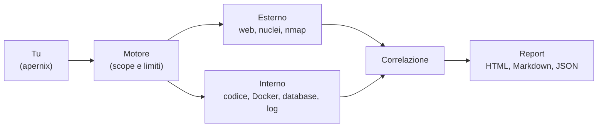

<p align="center">
  
</p>

<h1 align="center">Apernix</h1>

<p align="center">
  <strong>Trova i punti deboli della tua web application prima che lo faccia qualcun altro.</strong><br>
  Un solo comando, un solo report: da fuori come un visitatore, da dentro come chi gestisce la macchina.
</p>

<p align="center">🇮🇹 Italiano · Linux · Python 3.11+ · <a href="SECURITY.md">Sicurezza</a> · <a href="LICENSE">MIT</a></p>

<p align="center">
  <a href="#installazione-rapida">Installazione rapida</a> ·
  <a href="#guida-tecnica">Guida tecnica</a> ·
  <a href="#come-leggere-il-report">Il report</a> ·
  <a href="#sviluppi-futuri">Sviluppi futuri</a> ·
  <a href="#riferimenti">Riferimenti</a>
</p>

---

## In breve

Apernix è uno strumento di **Risk Assessment e VSPT** (Vulnerability Scanning + Penetration Testing) per applicazioni web. Gli dai l'indirizzo della tua applicazione e lui:

1. la **guarda da fuori**, come farebbe un visitatore o un attaccante: header, cookie, certificato, file che non dovrebbero essere pubblici, porte aperte, vulnerabilità note;
2. la **guarda da dentro**, se gli permetti di entrare nella macchina dove gira: codice sorgente, dipendenze, container Docker, database, log;
3. mette **tutto in un'unica tabella**: per ogni problema c'è l'elemento, la prova, l'esito della verifica, l'impatto, la probabilità e il **rischio** (impatto × probabilità);
4. ti dice **cosa sistemare prima**, con parole semplici.

Si installa con un comando e si avvia scrivendo `apernix`. Niente file da configurare a mano: ci pensa lui.

Fa parte della suite **Nemirix**, insieme a Vulpnix, Erinix e Strinix. Il nome viene dal latino *aper*, cinghiale: testardo, e non molla finché non ha trovato il punto debole. Vulpnix ed Erinix controllano **la macchina**; Apernix controlla **l'applicazione**.

## Ti serve Apernix?

Probabilmente sì, se ti riconosci in almeno una di queste situazioni:

- 🕵️ **Hai una web application e non sai quanto è sicura**, né da dove cominciare a controllare.
- 🧩 **Usi più strumenti** (nmap, nuclei, semgrep, trivy...) e ti ritrovi con risultati sparsi in tanti posti.
- 📋 **Devi consegnare un report di rischio** con prove, impatto e probabilità, non una lista di avvisi.
- 🔥 **Non sai cosa sistemare per primo**: ti serve una classifica, non 200 righe tutte uguali.
- 🐳 **La tua app gira in Docker** e vuoi controllare anche container e database, non solo il sito.

Probabilmente **no**, se ti serve un penetration test manuale e approfondito fatto da una persona, o se non hai il permesso di analizzare il sistema (vedi [Sicurezza](#sicurezza)).

## Che buchi tappa

| Il problema di oggi | Come lo risolve Apernix |
|---|---|
| Tanti strumenti, tanti formati | Li lancia lui, e unisce **esterno e interno in un'unica tabella**. |
| 60 avvisi uguali che nascondono i 3 veri | **Raggruppa** per regola, scarta i falsi allarmi più comuni e distingue ciò che ha *verificato* da ciò che è solo un segnale. |
| "Quanto è grave?" | Ogni problema ha **impatto × probabilità**, e il report dà un voto da A a F. |
| "E adesso cosa faccio?" | Un **piano d'azione** in tre colonne: subito, presto, quando puoi, con il rimedio per ognuno. |
| "Come faccio a fidarmi del risultato?" | Ogni riga mostra la **prova** e dice se il problema è stato **confermato**, non testato o non verificabile. |
| Configurare tutto a mano | La dashboard **trova da sola** le web application sulla macchina, i container e il database. |
| Strumenti che fanno danni | Solo richieste **non distruttive**, dentro uno **scope** che devi autorizzare tu. |

## Come funziona, in tre passi

**1. Avvia.** Scrivi `apernix`: si apre una dashboard che cerca le web application sulla tua macchina (porte pubblicate da Docker e porte in ascolto), oppure puoi indicare un URL.

**2. Autorizza e scegli.** Se il certificato HTTPS non è pubblico (per esempio quello interno di Caddy) ti mostra emittente e impronta e ti chiede se fidarti, **come fa SSH**. Poi chiede sempre una conferma esplicita: stai analizzando qualcosa di tuo, o di cui hai il permesso. Se l'app gira in Docker su questa macchina, propone di attivare anche l'analisi interna. Scegli il profilo: *Rapida* (pochi secondi, solo web) o *Completa* (web, vulnerabilità note, porte, analisi interna).

**3. Leggi il report.** A fine analisi premi `o` e si apre nel browser: voto, piano d'azione, cosa va già bene, ogni problema spiegato con prove e rimedio, mappa del rischio e la tabella unica.

## Cosa sa controllare

| Parte | Cosa controlla | Con quali fonti |
|---|---|---|
| **Dall'esterno** (Vulnerability Scanning) | header di sicurezza, cookie, HTTPS e certificato, versioni esposte, file che non dovrebbero essere pubblici (`.git`, `.env`, backup...), pagine di errore con dettagli interni, elenco di file, CORS, metodi HTTP, porte e servizi aperti, vulnerabilità note | Apernix, nmap, nuclei |
| **Verifica attiva** (Penetration Testing, non distruttivo) | ogni problema che richiede una prova (file esposto, errore che rivela dettagli, CORS che accetta siti a caso, porta che risponde) viene **verificato davvero con una richiesta**, senza modificare nulla; l'esito e la prova finiscono nel report | Apernix, nmap, nuclei |
| **Dall'interno** (analisi dell'app) | codice sorgente, dipendenze vulnerabili, segreti scritti nel codice, configurazione dei container Docker (privilegi, utente root, mount pericolosi, porte del database pubblicate, password banali), ruoli e permessi di PostgreSQL, log (credenziali, errori, accessi falliti) | semgrep, bandit, trivy, Docker, psql (dentro il container) |
| **Correlazione** | unisce esterno e interno: per esempio *database raggiungibile dalla rete* + *password debole* = catena grave | Apernix |

L'analisi interna funziona sulla **stessa macchina** o su **un'altra via SSH** (per esempio un Raspberry Pi).

## Installazione rapida

Ti serve un computer **Linux** con **Python 3.11 o più recente** e **git**. Niente `sudo`, niente permessi di amministratore.

```bash
git clone https://github.com/JustCromo/Apernix.git
cd Apernix
./install.sh --tools
apernix doctor
```

L'installatore crea un ambiente isolato in `~/.local/share/apernix` e il comando `apernix` in `~/.local/bin` (se quella cartella non è nel `PATH`, ti dice la riga da aggiungere a `~/.bashrc`). Con `--tools` installa anche semgrep e bandit. `apernix doctor` controlla cosa c'è e cosa manca, e **ti dà il comando giusto per la tua distribuzione** (Arch, Debian/Ubuntu, Fedora, openSUSE).

Poi basta:

```bash
apernix
```

Si aggiorna con `git pull`; si rimuove con `./install.sh --uninstall` (non tocca scope, report e certificati accettati).

## Come leggere il report

Ogni analisi crea una cartella privata (permessi 700) con data e bersaglio nel nome, per esempio `apernix-reports/2026-11-20_17-00_racoonix/`:

| File | Per chi |
|---|---|
| `report.html` | da aprire nel browser: **voto e verdetto in una frase, piano d'azione, cosa va già bene, ogni problema spiegato, mappa del rischio e la tabella unica** |
| `report.md` | la stessa tabella in Markdown |
| `report.json` | per altri programmi, formato stabile `apernix-report/1` |

Il report HTML è un **file unico**: senza JavaScript, senza risorse esterne, e con tutto il testo che arriva dall'applicazione analizzata reso innocuo.

### La tabella unica

Una riga per problema, con esterno e interno insieme: *Elemento, Problema, Evidenze, Esito PT, Impatto, Probabilità, Rischio, Fonte*.

### Calcolo del rischio

Impatto e probabilità vanno da 1 a 5, **rischio = impatto × probabilità** (1-25):

| Rischio | Livello |
|---|---|
| 1-4 | basso |
| 5-9 | medio |
| 10-16 | alto |
| 17-25 | critico |

La probabilità tiene conto del contesto: lo stesso problema (per esempio HTTP in chiaro) pesa meno su `127.0.0.1` che su Internet.

### Il voto (A-F)

Parte da 100 e scende per ogni problema, ma con un tetto per livello (alti -7 ciascuno fino a -35, medi -2 fino a -20, bassi -0,5 fino a -5, critici -25 ciascuno): tanti problemi dello stesso tipo non azzerano il voto. **La F è riservata a chi ha problemi critici.**

### L'esito della verifica (PT)

| Esito | Significa |
|---|---|
| `confermato` | il fatto è stato **osservato davvero**: una risposta del sito, la configurazione letta dal container o dal database |
| `non confermato` | la prova non è riuscita: il rischio potrebbe essere più basso |
| `non testato` | segnalato da analisi statica del codice o delle dipendenze, **non provato** |
| `non applicabile` | non c'è niente da provare (per esempio un header mancante) |

### Come si riducono i falsi allarmi

- L'analisi del codice ignora le cartelle di strumenti e documentazione al primo livello (`tools`, `scripts`, `docs`, `examples`, `build`, `dist`, `vendor`...) e i test: non sono l'applicazione in produzione.
- Le regole Django di semgrep sono scartate se il progetto non usa Django.
- Le regole "audit" (e le "blacklist" di bandit) indicano un punto da guardare, non una falla certa: rischio ridotto e nota "da verificare a mano" nelle evidenze.
- Lo stesso problema trovato da due fonti (Dockerfile senza `USER` e container che gira come root) compare una sola volta.

---

# Guida tecnica

Questa parte è per chi deve **installare, configurare e far girare** Apernix su una macchina vera.

## Requisiti e servizi

- **Linux** con **Python 3.11 o più recente** e il modulo `venv`. Provato su Arch con Python 3.13 e 3.14.
- **Nessun servizio di Apernix da avviare**: è un programma a riga di comando, parte e finisce.
- L'applicazione da analizzare deve essere **in esecuzione e raggiungibile** all'URL che indichi.
- Per l'analisi interna di un'app in Docker: il **demone Docker attivo** e un utente che può usare `docker` (gruppo `docker`).
- Per l'analisi interna di un'altra macchina: **`sshd` attivo** sulla macchina remota e una chiave SSH (vedi sotto).
- Per le fasi che scaricano le proprie regole (semgrep, trivy, nuclei): connessione a Internet al primo uso.

### Strumenti opzionali

Nessuno è obbligatorio: Apernix esegue le fasi possibili e **nel report dice quali fonti non erano disponibili**. Il controllo web dall'esterno funziona sempre.

| Strumento | A cosa serve | Come installarlo |
|---|---|---|
| nmap | porte e servizi esposti | pacchetto `nmap` (`pacman -S`, `apt install`, `dnf install`) |
| nuclei | vulnerabilità note (template pubblici) | release ufficiale: <https://github.com/projectdiscovery/nuclei/releases> in `~/.local/bin` |
| semgrep, bandit | analisi del codice | `./install.sh --tools` (li mette nell'ambiente di Apernix) |
| trivy | dipendenze vulnerabili, segreti, Dockerfile/compose | <https://trivy.dev/latest/getting-started/installation/> (Arch: `pacman -S trivy`) |
| docker | container e database dell'app | pacchetto della distribuzione |
| ssh | analisi interna di un'altra macchina | pacchetto `openssh` / `openssh-client` |

Alternativa manuale all'installatore: `python -m venv .venv && .venv/bin/pip install -e .` e poi `.venv/bin/apernix`.

## Come indicare il bersaglio (URL)

Il bersaglio sta nel file **`scope.toml`** (permessi 600, ignorato da git). Lo crea la dashboard, oppure si copia `scope.example.toml` e si modifica:

```toml
[authorization]
confirmed = true          # solo se il proprietario ti ha autorizzato
owner = "Nome Cognome"

[[target]]
url = "https://192.168.1.50:443/"       # <-- l'URL dell'applicazione
name = "La mia web application"
# ca_file = "ca.crt"                    # solo per HTTPS con CA interna (la dashboard la gestisce da sola)

[network]
ports = "top1000"         # nmap: none, top100, top1000, all, oppure "22,80,443"

[limits]
rate = 5                  # richieste al secondo
max_requests = 300        # tetto di richieste di Apernix
timeout = 10              # secondi per risposta
```

**Regola dello scope:** Apernix non invia richieste a indirizzi che non sono nello scope, nemmeno se il sito fa un redirect altrove. `confirmed = true` è obbligatorio.

## Accesso alla macchina e al database (analisi interna)

La sezione `[internal]` dello scope dice dove si trova l'applicazione. In locale si può **non scriverla**: la dashboard la compila da sola leggendo Docker (nomi dei container, cartella del progetto, utente e nome del database; le password non vengono mai lette). Per scriverla a mano:

```toml
[internal]
transport = "local"                         # "local" = questa macchina, "ssh" = un'altra
path = "/home/ivan/Projects/Racoonix"       # cartella con il codice dell'app
containers = ["racoonix-app-1", "racoonix-db-1"]   # container Docker da controllare (configurazione e log)
db_container = "racoonix-db-1"              # container PostgreSQL
db_user = "racoonix"                        # utente del database usato dall'app
db_name = "racoonix"
```

Per un'altra macchina si aggiungono i dati SSH:

```toml
[internal]
transport = "ssh"
host = "192.168.1.60"
user = "pi"
port = 22
key = "~/.ssh/id_apernix"                   # chiave privata, chmod 600
path = "/home/pi/app"                       # percorso sulla macchina remota
containers = ["app-web-1", "app-db-1"]
db_container = "app-db-1"
db_user = "app"
db_name = "appdb"
```

Regole di sicurezza dell'accesso SSH:

- **solo chiave**, mai password (`BatchMode=yes`, `PasswordAuthentication=no`): le password non vengono mai chieste né salvate;
- l'host deve essere **già in `~/.ssh/known_hosts`** (`StrictHostKeyChecking=yes`): la prima volta collegati a mano con `ssh utente@host` e verifica l'impronta;
- nessun inoltro di agent, porte o X11; la chiave deve avere permessi 600;
- sulla macchina remota **non si scrive nulla**: il codice viene solo letto (copia temporanea locale, cancellata a fine analisi).

### Permessi richiesti

| Cosa | Permesso |
|---|---|
| leggere il codice | lettura sulla cartella dell'app |
| container e log | utente nel gruppo `docker` (sulla macchina remota, quello dell'utente SSH) |
| database | `docker exec <container> psql` con l'utente indicato: servono solo **letture** (Apernix non scrive mai nel database); l'elenco dei ruoli è leggibile da qualsiasi utente, le regole `pg_hba` solo da un superuser (altrimenti quel controllo viene saltato) |
| SSH | chiave autorizzata sull'utente remoto, nessun `sudo` |

Il database non viene contattato direttamente in rete: si entra nel container con `docker exec`, quindi non serve aprire porte né salvare password.

## Come ottenere il report completo

```bash
apernix                                   # dashboard: scegli il bersaglio, profilo Completa, premi `o` a fine analisi
apernix scan --scope scope.toml           # stessa analisi da riga di comando (tutte le fasi)
apernix scan --only web,inside            # solo alcune fasi: web, nuclei, nmap, inside
apernix scan --quick                      # solo controlli web, in pochi secondi
apernix scan --json                       # uscita JSON stabile (formato apernix-report/1)
apernix report CARTELLA/report.json --format html > report.html     # rigenera un report (md, html, json)
```

**Codici di uscita:** `0` analisi completata senza rischi alti o critici, `1` trovati rischi alti o critici, `2` errore.

## La dashboard: tasti e comandi

`Tab` cambia sezione, `↑↓` sceglie una riga, `Invio` apre la sezione e poi agisce, `1`-`5` apre una sezione, `a` aggiunge un URL, `d` cerca di nuovo, `p` cambia profilo, `x` ferma, `o` apre il report nel browser, `Ctrl-L` ridisegna lo schermo, `?` guida, `q` esce. Serve un terminale di almeno 80x22; per terminali piccoli c'è `apernix menu` (console a numeri con lo stesso flusso).

| Comando | Cosa fa |
|---|---|
| `apernix` | dashboard a tutto schermo |
| `apernix scan` | analisi da riga di comando (vedi sopra) |
| `apernix report` | rigenera un report salvato |
| `apernix scope` | controlla lo scope e mostra i bersagli autorizzati |
| `apernix doctor` | controlla gli strumenti installati e come installare quelli che mancano |
| `apernix console` / `apernix menu` | console classica a comandi / console guidata a numeri |
| `apernix help`, `apernix version` | aiuto e versione (tutti i comandi accettano `--json`) |

---

## Sicurezza

Apernix è uno strumento di sicurezza e deve essere sicuro a sua volta:

- **scope obbligatorio** e conferma esplicita dell'autorizzazione: niente richieste fuori dall'elenco, nemmeno via redirect;
- **nessuna shell**: gli strumenti esterni partono con ambiente ridotto, tempo massimo e limite sull'output;
- **certificati accettati una volta sola** (TOFU) e poi legati a quell'impronta;
- **nessun segreto nel report**: se trova una password o una chiave scrive dove si trova, mai il valore;
- richieste **non distruttive**, con limite di velocità e di numero.

Dettagli e come segnalare un problema in privato: **[SECURITY.md](SECURITY.md)**.

> **Usalo solo su sistemi che hai il permesso di analizzare.** I report contengono informazioni sensibili: condividili solo con chi deve sistemare il problema.

## Com'è fatto



Python 3.11+ con `requests`, interfaccia a terminale con `curses`, test con `unittest`. Gli strumenti esterni (nmap, nuclei, semgrep, bandit, trivy, Docker, psql) sono **fonti** collegate al motore: ognuna produce risultati nello stesso formato e il report li unisce.

## Per sviluppatori

```
apernix/
├── cli.py, guided.py       comandi e console guidata
├── dashboard/              dashboard a terminale (stato, vista, tasti)
├── engine.py               motore: fasi, scope, eventi
├── scope.py, scope_write.py  lettura, controllo e scrittura dello scope
├── autoconf.py, discover.py  scoperta delle web application, container e database
├── web/                    controlli dall'esterno (header, cookie, file esposti, TLS, CORS...)
├── sources/                nmap, nuclei, semgrep, bandit, trivy
├── inside/                 analisi interna: transport (locale/SSH), container, database, log
├── correlate.py            catene di problemi e doppioni
├── report.py, report_html.py  report JSON/Markdown e HTML
├── doctor.py, tools.py     controllo degli strumenti e loro esecuzione sicura
└── locales/it.json         tutti i testi per l'utente (una lingua per file)
tests/                      test automatici (cartelle temporanee e server locali)
```

```bash
python -m unittest discover -s tests      # test automatici
ruff check .                              # controllo dello stile (opzionale)
```

## Limiti noti

- La **verifica attiva (PT)** è non distruttiva e per ora si limita a confermare ciò che Apernix e le sue fonti hanno già osservato davvero in una risposta. Prove più profonde (iniezioni, credenziali deboli, controllo degli accessi dopo il login) **non sono ancora implementate**: sono tra gli [sviluppi futuri](#sviluppi-futuri).
- La parte dell'applicazione protetta da login non viene vista dall'esterno; l'analisi interna la copre via codice, database e log.
- L'analisi del database supporta **PostgreSQL** in Docker; MySQL/MariaDB e database non containerizzati sono futuri.
- La **modalità sistema** (analisi della macchina) è demandata a Erinix e Vulpnix.
- Solo Linux; interfaccia solo in italiano per ora.
- semgrep può dare falsi positivi: ogni risultato indica la regola e il punto del codice da verificare a mano. Le cartelle escluse non vengono analizzate: se l'app vive in una di esse, il codice non viene visto.

## Sviluppi futuri

- **Penetration Testing più profondo**, sempre non distruttivo: iniezioni e XSS con dati innocui, credenziali di prova fornite dal proprietario, controllo dei permessi tra utenti e ruoli.
- **Più database e più server**: MySQL/MariaDB, database non containerizzati, analisi della configurazione del web server (Caddy, nginx).
- **Modalità sistema** e interfaccia unica con Vulpnix, Erinix e Strinix (Nemirix).
- **Confronto tra due report** (cosa è migliorato), lingua inglese, esportazione PDF.
- **Test e scansioni automatici** su GitHub Actions a ogni modifica.

## Riferimenti

- [OWASP Top 10](https://owasp.org/www-project-top-ten/) e [OWASP Web Security Testing Guide](https://owasp.org/www-project-web-security-testing-guide/)
- [OWASP Risk Rating Methodology](https://owasp.org/www-community/OWASP_Risk_Rating_Methodology): il calcolo del rischio come impatto × probabilità
- [nmap](https://nmap.org/book/), [nuclei](https://docs.projectdiscovery.io/), [semgrep](https://semgrep.dev/docs/), [bandit](https://bandit.readthedocs.io/), [trivy](https://trivy.dev/)
- [CIS Docker Benchmark](https://www.cisecurity.org/benchmark/docker)
- [PostgreSQL: `pg_hba.conf`](https://www.postgresql.org/docs/current/auth-pg-hba-conf.html)

## Autore

Apernix è un progetto di **Ivan** ([JustCromo](https://github.com/JustCromo)), nato per il corso *System Cyber Security* dell'ITS Academy Prodigi.

Licenza [MIT](LICENSE).
